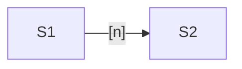
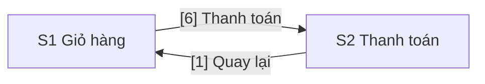

<!--
Template for the `design` artifact in contract/policies.yaml: the screens of one Epic, saved as docs/specs/<EPIC-KEY>/design.md
by `ux` when the Epic touches the UI. Images of Figma screens go to docs/specs/<EPIC-KEY>/design/.
Keep headings and YAML keys in English and write the content in Vietnamese.
Run `node .ai-orchestrator/scripts/check-design.mjs <this file>` until it reports no error, then commit.
Delete the guidance comments and the Example section when you are done.
-->

# Design: <Epic name>

> **Epic:** <EPIC-KEY> · **Jira:** <link to the Epic> · **Spec:** docs/specs/<EPIC-KEY>/spec.md · **Status:** Draft | Approved <YYYY-MM-DD>
>
> **Figma version:** <name of the approved version in Figma's version history, or "none" when no screen is a Figma screen>

## Screens

<!-- One row per screen. Codes S1, S2… never change after the SPEC is approved: a removed screen leaves its code unused.
Kind is ASCII when the screen has no Figma design yet, and Figma when it has one. -->

| Code | Name | Route | User story | Kind |
|---|---|---|---|---|
| S1 | <name> | <route> | <user story of the SPEC> | ASCII |
| S2 | <name> | <route> | <user story of the SPEC> | Figma |

## Flow

<!-- Screen codes are the node names; write the block that triggers each move on its arrow. -->



## Screen Details

<!-- One subsection per screen, in code order. Each screen has exactly one kind:
- ASCII: a ```text drawing whose first line is "S<n> · <name> · <screen size>". Draw frames with + - | [ ] _ only, no
  Unicode box characters or emoji, at most 100 columns per line. Number blocks [1], [2]… in reading order (top to bottom,
  left to right), which is also the expected Tab order. Inside the frame put only numbers and short labels; [ ] and [___]
  are input boxes, not block codes. Draw another screen size only when the layout changes, for example on mobile.
- Figma: the exported images, desktop and mobile when there is one, as .
  Export at 1x as PNG or JPG; each image at most 1 MB and at most 2,000 px on its long side; slice a long frame.
  Commit only approved images, with the SPEC.
Right under the drawing or the images comes one ```yaml block with `screen`, `route`, `blocks`, and for a Figma screen
`figma`, the link of the frame with its node-id. Each block has `name` and `type`, and when needed `content`, `behavior`,
`validation`, `states`, `a11y`, `ac` (AC<n> codes of the SPEC) and `figma` (node id of the layer). Elsewhere, point to a
block by its full code, for example S1.4. After approval a removed block leaves its number unused, and a new block takes
the next number. -->

### S1 · <name>

```text
S1 · <name> · desktop
+--------------------------------------+
| [1] <label>                          |
| [2] <label>                          |
+--------------------------------------+
```

```yaml
screen: S1
route: <route>
blocks:
  1:
    name: <name>
    type: <heading | text | input | button | link | list | image | ...>
  2:
    name: <name>
    type: <type>
    behavior: <what happens>
    ac: [AC1]
```

### S2 · <name>


```yaml
screen: S2
route: <route>
figma: https://www.figma.com/design/<file-key>/<file-name>?node-id=<frame-id>
blocks:
  1:
    name: <name as seen in the image>
    type: <type>
    figma: "<layer node id>"
```

## Open Questions

<!-- What the design does not settle yet. For a Figma screen, also what Figma lacks: error states, the mobile layout,
message texts. -->

## Example

<details>
<summary>Ví dụ: Epic "Mã giảm giá cho giỏ hàng" (DEMO-20)</summary>

````markdown
# Design: Mã giảm giá cho giỏ hàng

> **Epic:** DEMO-20 · **Jira:** https://example.atlassian.net/browse/DEMO-20 · **Spec:** docs/specs/DEMO-20/spec.md · **Status:** Approved 2026-11-05
>
> **Figma version:** Checkout v3, duyệt ngày 2026-11-04

## Screens
| Code | Name | Route | User story | Kind |
|---|---|---|---|---|
| S1 | Giỏ hàng | /cart | Là khách, tôi muốn nhập mã giảm giá để trả ít hơn | ASCII |
| S2 | Thanh toán | /checkout | Là khách, tôi muốn thấy số tiền đã giảm trước khi trả | Figma |

## Flow


## Screen Details

### S1 · Giỏ hàng

```text
S1 · Giỏ hàng · desktop
+--------------------------------------------------+
| [1] Danh sách sản phẩm                           |
+--------------------------------------------------+
| [2] Mã giảm giá [______________]  [3] (Áp dụng)  |
| [4] Thông báo của mã                             |
| [5] Tổng tiền                                    |
|                                [6] (Thanh toán)  |
+--------------------------------------------------+
```

```yaml
screen: S1
route: /cart
blocks:
  1:
    name: Danh sách sản phẩm
    type: list
    content: Tên, đơn giá, số lượng và thành tiền của từng sản phẩm
  2:
    name: Ô nhập mã giảm giá
    type: input
    validation: 6–12 ký tự chữ và số; sai định dạng thì hiện [4]
    a11y: Nhãn "Mã giảm giá" gắn với ô nhập
    ac: [AC1, AC3]
  3:
    name: Nút Áp dụng
    type: button
    behavior: Kiểm mã. Hợp lệ thì trừ vào [5] và hiện [4] màu xanh; không hợp lệ thì hiện [4] màu đỏ
    states:
      checking: Khóa nút, hiện vòng xoay
    ac: [AC1, AC2]
  4:
    name: Thông báo của mã
    type: text
    content: '"Đã giảm 10%", hoặc "Mã không hợp lệ hoặc đã hết hạn"'
    a11y: Vùng aria-live, để trình đọc màn hình đọc thông báo
    ac: [AC2]
  5:
    name: Tổng tiền
    type: text
    content: Tạm tính, giảm giá, phí vận chuyển và tổng cộng
    ac: [AC1]
  6:
    name: Nút Thanh toán
    type: button
    behavior: Sang S2, giữ mã đã áp dụng
```

### S2 · Thanh toán


```yaml
screen: S2
route: /checkout
figma: https://www.figma.com/design/AbCdEf123/Shop?node-id=12-345
blocks:
  1:
    name: Liên kết Quay lại giỏ hàng
    type: link
    behavior: Về S1
    figma: "12:350"
  2:
    name: Dòng Giảm giá
    type: text
    content: Mã đã áp dụng và số tiền được giảm
    figma: "12:367"
    ac: [AC1]
  3:
    name: Nút Đặt hàng
    type: button
    behavior: Tạo đơn với tổng tiền đã giảm
    figma: "12:372"
```

## Open Questions
- Figma chưa có trạng thái khi mã hết hạn giữa lúc thanh toán. Đề xuất: quay về S1 và hiện S1.4.
````

</details>
