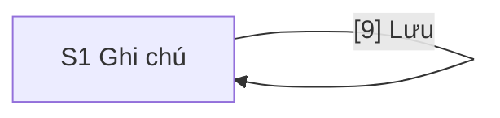

# Design: Ghi chú: tạo và xem danh sách

> **Epic:** SMP-2 · **Jira:** https://phunghuutung12b4.atlassian.net/browse/SMP-2 · **Spec:** docs/specs/SMP-2/spec.md · **Status:** Approved 2026-11-02
>
> **Figma version:** none

## Screens

| Code | Name | Route | User story | Kind |
|---|---|---|---|---|
| S1 | Ghi chú | /notes | Story Tạo ghi chú (AC1–AC9): Là người dùng, tôi muốn tạo một ghi chú có tiêu đề và nội dung để lưu lại điều mình cần nhớ. Story Xem danh sách ghi chú (AC10–AC13): Là người dùng, tôi muốn xem danh sách các ghi chú đã tạo để đọc lại chúng. | ASCII |

## Flow



## Screen Details

### S1 · Ghi chú

```text
S1 · Ghi chú · desktop
+------------------------------------------------------------------------------+
| [1] Khung trang: cột giữa, rộng tối đa 640 px                                |
|                                                                              |
| [2] Ghi chú                                                                  |
|                                                                              |
| [3] Tạo ghi chú                                                              |
| [4] Tiêu đề                                                                  |
| [__________________________________________________________________________] |
| [5] Lỗi của ô Tiêu đề                                                        |
| [6] Nội dung                                                                 |
| [                                                                          ] |
| [                                                                          ] |
| [                                                                          ] |
| [                                                                          ] |
| [7] Lỗi của ô Nội dung                                                       |
| [8] Lỗi lưu, chung cho cả form                                               |
| [9] (Lưu)                                                                    |
|                                                                              |
| [10] Danh sách ghi chú                                                       |
| [11] Danh sách, mới nhất ở trên                                              |
| +--------------------------------------------------------------------------+ |
| | [12] Tiêu đề ghi chú                                  [13] Thời gian tạo | |
| | [14] Nội dung ghi chú                                                    | |
| +--------------------------------------------------------------------------+ |
| (các ghi chú cũ hơn xếp dưới, cùng dạng)                                     |
| hoặc, thay cho cả danh sách:                                                 |
| [15] Thông báo chưa có ghi chú, hoặc lỗi tải                                 |
+------------------------------------------------------------------------------+
```

```text
S1 · Ghi chú · mobile
+------------------------------------------+
| [1] Khung trang: đầy chiều rộng          |
|                                          |
| [2] Ghi chú                              |
|                                          |
| [3] Tạo ghi chú                          |
| [4] Tiêu đề                              |
| [______________________________________] |
| [5] Lỗi của ô Tiêu đề                    |
| [6] Nội dung                             |
| [                                      ] |
| [                                      ] |
| [                                      ] |
| [                                      ] |
| [7] Lỗi của ô Nội dung                   |
| [8] Lỗi lưu, chung cho cả form           |
| (       [9] Lưu, rộng hết dòng         ) |
|                                          |
| [10] Danh sách ghi chú                   |
| [11] Danh sách, mới nhất ở trên          |
| +--------------------------------------+ |
| | [12] Tiêu đề ghi chú                 | |
| | [13] Thời gian tạo                   | |
| | [14] Nội dung ghi chú                | |
| +--------------------------------------+ |
| (các ghi chú cũ hơn xếp dưới)            |
| hoặc, thay cho cả danh sách:             |
| [15] Thông báo chưa có ghi chú,          |
|      hoặc lỗi tải                        |
+------------------------------------------+
```

```yaml
screen: S1
route: /notes
blocks:
  1:
    name: Khung trang
    type: layout
    content: >-
      Một cột duy nhất: tiêu đề trang, form tạo ghi chú, rồi danh sách. Không có thanh điều hướng
      hay chân trang. Nền và chữ dùng --background và --foreground của globals.css, theo chế độ
      sáng hoặc tối của máy. Giao diện phẳng: không đổ bóng, không gradient, bo góc 4 px giống
      nhau ở ô nhập, nút và mục danh sách.
    behavior: >-
      Mở / thì chuyển thẳng tới /notes. Cột căn giữa, rộng tối đa 640 px. Khoảng cách theo thang
      4 px: các khối trong form cách nhau 16 px, form và danh sách cách nhau 32 px, lề ngang 16 px
      dưới 768 px và 24 px từ 768 px. Dưới 768 px dùng bản vẽ mobile, thiết kế từ 320 px. Ở 1024 px
      và 1440 px bố cục như ở 768 px, chỉ rộng thêm lề hai bên. Ở 320 px không có thanh cuộn
      ngang, và khi phóng chữ 200% vẫn dùng được.
    a11y: >-
      Thẻ html có lang="vi" (layout.tsx hiện đặt "en") và tên tab là "Ghi chú". Phần chính nằm
      trong main. Có một h1 (khối 2), h2 cho khối 3 và 10, h3 cho từng ghi chú (khối 12), không
      nhảy cấp. Dùng được hoàn toàn bằng bàn phím; thứ tự Tab là 4, 6, 9, và danh sách không có
      phần tử nào nhận Tab. Màu chữ, màu lỗi và màu chữ phụ đạt tương phản 4.5:1 với nền ở cả
      chế độ sáng và tối.
  2:
    name: Tiêu đề trang
    type: heading
    content: h1 "Ghi chú"
  3:
    name: Tên form
    type: heading
    content: h2 "Tạo ghi chú"
    a11y: >-
      Form có aria-labelledby trỏ tới tiêu đề này, nên trình đọc màn hình đọc là form "Tạo ghi
      chú". Form đặt novalidate để trình duyệt không hiện thông báo của nó thay cho [5] và [7].
  4:
    name: Ô Tiêu đề
    type: input
    content: Nhãn "Tiêu đề" nằm trên một ô nhập một dòng. Không có chữ gợi ý trong ô.
    validation: >-
      Bắt buộc, 1–100 ký tự sau khi bỏ khoảng trắng ở đầu và cuối, đếm theo ký tự Unicode sau
      NFC. Trống hoặc chỉ có khoảng trắng thì hiện [5] "Vui lòng nhập tiêu đề"; quá 100 ký tự
      thì hiện [5] "Tiêu đề tối đa 100 ký tự". Ô không chặn gõ thêm (không đặt maxlength).
    behavior: >-
      Lỗi "Vui lòng nhập tiêu đề" hiện khi rời ô lúc nó trống, hoặc khi bấm Lưu. Lỗi quá dài hiện
      ngay trong lúc gõ khi vượt 100 ký tự. Lỗi biến mất ngay khi giá trị hợp lệ trở lại, không
      cần bấm Lưu. Nhấn Enter trong ô thì như bấm Lưu [9]. Khi bấm Lưu mà ô này sai, con trỏ
      chuyển vào đây. Sau khi lưu thành công ô trống lại và nhận con trỏ, để nhập ghi chú tiếp.
    states:
      default: Viền 1 px
      focus: Viền nhấn 2 px kèm vòng focus nhìn rõ, tương phản ít nhất 3:1 với nền
      error: Viền 2 px màu lỗi, kèm [5] ngay bên dưới
      saving: Chỉ đọc (readonly, không dùng disabled) và giữ nguyên chữ, để không mất chữ gõ thêm
    a11y: >-
      Nhãn là thẻ label gắn với ô, nên tên truy cập của ô là "Tiêu đề". Có aria-required="true".
      Khi có lỗi: aria-invalid="true" và aria-describedby trỏ tới [5]; khi hết lỗi bỏ cả hai, để
      mô tả truy cập của ô đúng bằng nguyên văn thông báo và không có gì khác. autocomplete="off".
    ac: [AC1, AC2, AC3, AC4, AC6, AC8]
  5:
    name: Lỗi của ô Tiêu đề
    type: text
    content: '"Vui lòng nhập tiêu đề" hoặc "Tiêu đề tối đa 100 ký tự"; hai lỗi không hiện cùng lúc'
    behavior: >-
      Luôn chiếm chỗ một dòng (cao 20 px) kể cả khi không có lỗi, để lỗi hiện ra không đẩy nút
      Lưu xuống lúc người dùng đang bấm vào nó.
    states:
      none: Không có chữ
      error: Chữ màu lỗi, kèm biểu tượng lỗi đứng trước chữ, nên lỗi không chỉ phân biệt bằng màu
    a11y: >-
      Có id để [4] trỏ tới bằng aria-describedby. Là vùng aria-live="polite", nên lỗi hiện ra
      trong lúc gõ được đọc một lần. Biểu tượng chỉ để trang trí (aria-hidden).
    ac: [AC3, AC4, AC6]
  6:
    name: Ô Nội dung
    type: textarea
    content: >-
      Nhãn "Nội dung" nằm trên một ô nhiều dòng, cao tối thiểu 4 dòng, kéo giãn được theo chiều
      dọc. Nội dung không bắt buộc. Không có chữ gợi ý trong ô.
    validation: >-
      0–1000 ký tự, đếm theo ký tự Unicode sau NFC, không bỏ khoảng trắng. Quá 1000 ký tự thì
      hiện [7] "Nội dung tối đa 1000 ký tự". Ô không chặn gõ thêm (không đặt maxlength).
    behavior: >-
      Enter xuống dòng, không gửi form. Các lần xuống dòng được lưu nguyên. Lỗi quá dài hiện ngay
      trong lúc gõ khi vượt 1000 ký tự và biến mất ngay khi giá trị hợp lệ trở lại. Nếu [4]
      hợp lệ mà ô này sai, bấm Lưu chuyển con trỏ vào đây.
    states:
      default: Viền 1 px
      focus: Viền nhấn 2 px kèm vòng focus nhìn rõ, tương phản ít nhất 3:1 với nền
      error: Viền 2 px màu lỗi, kèm [7] ngay bên dưới
      saving: Chỉ đọc (readonly, không dùng disabled) và giữ nguyên chữ
    a11y: >-
      Nhãn là thẻ label gắn với ô, nên tên truy cập của ô là "Nội dung". Khi có lỗi:
      aria-invalid="true" và aria-describedby trỏ tới [7]; khi hết lỗi bỏ cả hai. Cỡ chữ trong ô
      ít nhất 16 px để trình duyệt trên điện thoại không tự phóng to khi nhận con trỏ.
    ac: [AC1, AC2, AC5, AC6, AC8]
  7:
    name: Lỗi của ô Nội dung
    type: text
    content: '"Nội dung tối đa 1000 ký tự"'
    behavior: Luôn chiếm chỗ một dòng (cao 20 px) kể cả khi không có lỗi, như [5].
    states:
      none: Không có chữ
      error: Chữ màu lỗi, kèm biểu tượng lỗi đứng trước chữ
    a11y: Giống [5], có id để [6] trỏ tới, là vùng aria-live="polite", biểu tượng aria-hidden.
    ac: [AC5, AC6]
  8:
    name: Lỗi lưu
    type: text
    content: '"Không lưu được ghi chú. Vui lòng thử lại."'
    behavior: >-
      Hiện ngay trên nút Lưu khi API không lưu được ghi chú, do lỗi mạng hoặc lỗi máy chủ. Chữ
      trong [4] và [6] giữ nguyên. Biến mất lúc người dùng bấm Lưu lại (khi yêu cầu được gửi) và
      hiện lại nếu lỗi lại; cũng biến mất khi lưu thành công. Không chiếm chỗ khi không có lỗi.
    states:
      none: Không vẽ khối này
      error: Chữ màu lỗi, kèm biểu tượng lỗi đứng trước chữ
    a11y: >-
      role="alert", để trình đọc màn hình đọc ngay khi hiện ra. Con trỏ vẫn ở nút Lưu, không
      chuyển đi. Biểu tượng chỉ để trang trí (aria-hidden).
    ac: [AC8]
  9:
    name: Nút Lưu
    type: button
    content: Nút chính của form, chữ "Lưu", cao ít nhất 44 px. Rộng vừa chữ và căn trái ở desktop; rộng hết dòng ở mobile.
    behavior: >-
      Gửi form. Nếu [4] hoặc [6] sai thì không gửi yêu cầu nào, hiện lỗi của từng ô và chuyển con
      trỏ vào ô sai đầu tiên theo thứ tự [4], [6]. Nếu hợp lệ thì gửi tới API. Lưu thành công thì
      ghi chú mới hiện ở đầu [11], [4] và [6] trống lại, mọi lỗi biến mất và con trỏ về [4]. Lưu
      không được thì hiện [8], dữ liệu còn nguyên.
    states:
      default: Nền nhấn, chữ tương phản ít nhất 4.5:1
      hover: Nền đậm hơn một bậc
      focus: Vòng focus 2 px, cách nút 2 px
      saving: >-
        Có vòng xoay nhỏ đứng trước chữ "Lưu", chữ giữ nguyên. Đặt aria-disabled="true" và
        aria-busy="true"; bấm hoặc nhấn Enter trong [4] lúc này không gửi thêm yêu cầu nào, nên
        chỉ có một ghi chú được tạo. Không dùng disabled, để con trỏ không bị mất khỏi nút.
    a11y: Là button type="submit" trong form, nên Enter ở [4] cũng gửi form. Tên truy cập là "Lưu".
    ac: [AC1, AC2, AC3, AC4, AC5, AC7, AC8]
  10:
    name: Tên danh sách
    type: heading
    content: h2 "Danh sách ghi chú"
  11:
    name: Danh sách ghi chú
    type: list
    content: >-
      Mọi ghi chú, mới nhất ở trên, không phân trang. Danh sách không có thanh cuộn riêng: cả
      trang cuộn. Các mục cách nhau bằng đường kẻ 1 px, mỗi mục cách đường kẻ 16 px.
    behavior: >-
      Ghi chú vừa lưu thành công hiện ở đầu ngay khi API trả lời, không tải lại trang và không
      có hiệu ứng chuyển động. Khi chưa có ghi chú hoặc không tải được, khối này không vẽ và
      [15] hiện thay cho nó.
    states:
      loading: >-
        Ba hàng khung xương cao bằng một mục, không có chữ. Đặt aria-busy="true". Form vẫn dùng
        được trong lúc này.
      filled: Các mục [12], [13], [14]
    a11y: ul và li thật, để trình đọc màn hình báo số mục. Mục không phải liên kết hay nút, nên không nhận Tab.
    ac: [AC1, AC2, AC11]
  12:
    name: Tiêu đề của ghi chú
    type: heading
    content: >-
      Tiêu đề đã lưu (đã bỏ khoảng trắng đầu và cuối), chữ đậm vừa, hiện như chữ thuần: tiêu đề
      "<b>đậm</b>" hiện đúng từng ký tự đó. Xuống dòng khi dài; từ dài không có dấu cách thì bẻ
      dòng (overflow-wrap: anywhere), không cắt bằng dấu ba chấm.
    a11y: h3 trong li.
    ac: [AC11, AC12]
  13:
    name: Thời gian tạo
    type: text
    content: >-
      Dạng dd/MM/yyyy HH:mm, giờ 24 giờ theo múi giờ của máy người dùng, ví dụ 02/11/2026 14:40.
      Chữ phụ, nhỏ hơn chữ của [14] một cấp. Ở desktop nằm bên phải, cùng hàng với [12] và không
      xuống dòng; ở mobile nằm ngay dưới [12].
    a11y: Là thẻ time có thuộc tính datetime theo ISO 8601. Màu chữ phụ đạt tương phản 4.5:1.
    ac: [AC11]
  14:
    name: Nội dung của ghi chú
    type: text
    content: >-
      Toàn bộ nội dung, không rút gọn và không có "xem thêm". Giữ nguyên các lần xuống dòng
      (white-space: pre-wrap); từ dài thì bẻ dòng như [12]. Hiện như chữ thuần: không hiểu HTML
      hay Markdown, đường link không bấm được.
    behavior: Ghi chú có nội dung trống thì không vẽ khối này; mục chỉ còn [12] và [13].
    ac: [AC2, AC11, AC12]
  15:
    name: Thông báo thay cho danh sách
    type: text
    content: '"Chưa có ghi chú nào." hoặc "Không tải được danh sách ghi chú. Vui lòng thử lại."'
    behavior: >-
      Hiện thay cho [11], đúng một trong hai thông báo, nằm ngay dưới [10]. [15] và [11] không
      bao giờ hiện cùng lúc.
    states:
      empty: 'Chữ màu phụ, căn trái. Đặt role="status". Hiện khi API trả danh sách rỗng.'
      error: 'Chữ màu lỗi, kèm biểu tượng lỗi đứng trước chữ. Đặt role="alert". Hiện khi API không trả được danh sách.'
    a11y: Biểu tượng lỗi chỉ để trang trí (aria-hidden). Màu chữ đạt tương phản 4.5:1.
    ac: [AC10, AC13]
```

## Open Questions

Các câu hỏi dưới đây chưa có người trả lời, nên mỗi câu có đề xuất của `ux`. Chỗ nào ghi "design chưa có" thì dev không làm cho tới khi được duyệt và design được sửa.

- **Không có Figma.** Epic không có link khung Figma và hộp `.ai/design-inbox/SMP-2/` trống, nên S1 là ASCII và dòng Figma version là `none`. Hình ASCII không vẽ được màu, cỡ chữ hay khoảng cách; các giá trị đó nằm trong YAML của S1. Đề xuất: Epic thử này không cần Figma. Nếu sau này có, S1 và số khối giữ nguyên.
- **Chữ ngoài mục Rules của SPEC.** `ux` đặt h1 "Ghi chú", h2 "Tạo ghi chú", h2 "Danh sách ghi chú", nhãn "Tiêu đề" và "Nội dung", nút "Lưu", theo từ của SPEC. Nhãn và nút trùng với ví dụ test trong SPEC (`getByRole('button', { name: 'Lưu' })`). Đề xuất: giữ như design.
- **Đánh dấu ô bắt buộc.** SPEC nói Tiêu đề bắt buộc và Nội dung không. Đề xuất: không thêm dấu sao hay chữ "(không bắt buộc)", vì mô tả truy cập của ô phải đúng bằng nguyên văn thông báo lỗi; ô Tiêu đề đã có `aria-required`. Design chưa có dấu đánh dấu nào.
- **Báo đã lưu cho trình đọc màn hình.** Lưu thành công chỉ làm ghi chú mới hiện ở đầu danh sách, nên người dùng trình đọc màn hình không nghe gì. Đề xuất: thêm một dòng ẩn khỏi mắt, `role="status"`, đọc "Đã lưu ghi chú." Design chưa có dòng này vì SPEC không nêu chữ đó.
- **Danh sách đang lỗi tải mà lưu thành công.** SPEC không nói [15] hiện lỗi thì ghi chú mới đi đâu. Đề xuất: sau khi lưu thành công, tải lại danh sách; tải được thì hiện danh sách, không thì giữ [15]. Không chèn ghi chú mới vào một danh sách thiếu.
- **Nút thử lại cho lỗi tải danh sách.** Thông báo nói "Vui lòng thử lại" nhưng không có nút. Đề xuất: không thêm; người dùng tải lại trang. Nếu thêm, đặt nút "Thử lại" dưới [15]. Design chưa có nút này.
- **API trả 400 trong khi form thấy hợp lệ.** Có thể xảy ra nếu form và API đếm ký tự khác nhau. Đề xuất: coi như lưu không được, hiện [8] và giữ dữ liệu trong form.
- **Cách đếm lần xuống dòng ở Nội dung.** Giá trị của ô nhiều dòng trong trình duyệt dùng một ký tự `\n` cho mỗi lần xuống dòng, còn yêu cầu gửi thẳng tới API có thể dùng `\r\n`, tức hai ký tự. Hai bên sẽ đếm khác nhau ở giới hạn 1000. Đề xuất cho `ba` và `sa`: ghi vào SPEC rằng mỗi lần xuống dòng tính 1 ký tự và API đổi `\r\n` thành `\n` trước khi đếm.
- **Bộ đếm ký tự.** SPEC không có. Đề xuất: không thêm, vì lỗi quá dài đã hiện ngay khi vượt giới hạn. Design chưa có bộ đếm.
- **AC9 không có khối giao diện.** AC9 chỉ về yêu cầu gửi thẳng tới API nên không khối nào của S1 trỏ tới nó; AC9 được kiểm ở integration test và E2E của API.
