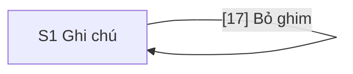

# Design: Ghim ghi chú lên đầu danh sách

> **Epic:** SMP-23 · **Jira:** https://phunghuutung12b4.atlassian.net/browse/SMP-23 · **Spec:** docs/specs/SMP-23/spec.md · **Status:** Draft
>
> **Figma version:** none

## Screens

| Code | Name | Route | User story | Kind |
|---|---|---|---|---|
| S1 | Ghi chú | /notes | Story Ghim ghi chú (AC1–AC5): Là người dùng, tôi muốn ghim một ghi chú quan trọng lên đầu danh sách, để ghi chú mới không đẩy nó xuống. Story Bỏ ghim ghi chú (AC6–AC7): Là người dùng, tôi muốn bỏ ghim một ghi chú khi không cần nó ở đầu nữa, để nhường chỗ cho ghi chú khác. Story Giới hạn 3 ghi chú được ghim (AC8–AC11): Là người dùng, tôi muốn chỉ có tối đa 3 ghi chú được ghim, để đầu danh sách luôn gọn và đúng là những ghi chú quan trọng nhất. | ASCII |

## Flow



## Screen Details

S1 ở đây là màn hình S1 Ghi chú của SMP-2 (`docs/specs/SMP-2/design.md`, đã duyệt), nên file này chỉ vẽ phần thay đổi: mỗi mục của danh sách. Cách đọc:

- Khối 1 tới 10 và khối 15 của S1 giữ nguyên như SMP-2, không vẽ lại.
- Khối 11 tới 14 được cập nhật ở những chỗ YAML nêu. Phần còn lại của chúng giữ như SMP-2.
- Khối 16 tới 19 là khối mới. Vì S1 đã được duyệt, khối mới lấy số tiếp theo, nên số khối không theo thứ tự đọc; thứ tự Tab ghi ở khối 11.
- Ghi chú chưa ghim trong hình không đánh số, trừ khối 18. Nút `(Ghim)` của nó là khối 17 ở trạng thái khác, và tiêu đề, thời gian, nội dung của nó là khối 12, 13, 14.

### S1 · Ghi chú

```text
S1 · Ghi chú · desktop
+------------------------------------------------------------------------------+
| (các khối 1 tới 10 của S1 giữ nguyên, như trong SMP-2)                       |
|                                                                              |
| [11] Danh sách: ghi chú đã ghim ở trên, rồi tới ghi chú chưa ghim            |
| +--------------------------------------------------------------------------+ |
| | [16] Đã ghim                                                             | |
| | [12] Tiêu đề ghi chú                                  [13] Thời gian tạo | |
| | [14] Nội dung ghi chú                                                    | |
| | [17] (Bỏ ghim)                                                           | |
| | [19] Lỗi bỏ ghim, chỉ hiện khi có lỗi                                    | |
| +--------------------------------------------------------------------------+ |
| (hai ghi chú đã ghim khác, cùng dạng)                                        |
| +--------------------------------------------------------------------------+ |
| | Tiêu đề ghi chú                                            Thời gian tạo | |
| | Nội dung ghi chú                                                         | |
| | (Ghim)  [18] Bỏ ghim một ghi chú để ghim ghi chú này                     | |
| +--------------------------------------------------------------------------+ |
| (các ghi chú chưa ghim khác, cùng dạng, mới nhất ở trên)                     |
| hoặc, thay cho cả danh sách: thông báo 15 của SMP-2, không đổi               |
+------------------------------------------------------------------------------+
```

```text
S1 · Ghi chú · mobile
+----------------------------------------+
| (các khối 1 tới 10 giữ nguyên)         |
|                                        |
| [11] Danh sách, đã ghim ở trên         |
| +------------------------------------+ |
| | [16] Đã ghim                       | |
| | [12] Tiêu đề ghi chú               | |
| | [13] Thời gian tạo                 | |
| | [14] Nội dung ghi chú              | |
| | [17] (Bỏ ghim)                     | |
| | [19] Lỗi bỏ ghim, nếu có           | |
| +------------------------------------+ |
| (hai ghi chú đã ghim khác)             |
| +------------------------------------+ |
| | Tiêu đề ghi chú                    | |
| | Thời gian tạo                      | |
| | Nội dung ghi chú                   | |
| | (Ghim)                             | |
| | [18] Bỏ ghim một ghi chú để ghim   | |
| |      ghi chú này                   | |
| +------------------------------------+ |
| (các ghi chú chưa ghim khác)           |
| hoặc, thay cho cả danh sách:           |
| thông báo 15 của SMP-2, không đổi      |
+----------------------------------------+
```

```yaml
screen: S1
route: /notes
blocks:
  11:
    name: Danh sách ghi chú
    type: list
    content: >-
      Vẫn một danh sách duy nhất, không chia nhóm và không có tiêu đề nhóm. Các ghi chú đã ghim đứng
      đầu, ghi chú ghim gần nhất ở trên cùng, rồi tới các ghi chú chưa ghim, mới nhất ở trên (mục
      Rules của SPEC). Thứ tự do API trả về, web không tự sắp lại. Có tối đa 3 mục đã ghim. Kiểu của
      mục, đường kẻ 1 px giữa hai mục và khoảng cách 16 px giữ như SMP-2. Hai nhóm chỉ khác nhau ở
      khối 16 và 17: nhóm đã ghim không có nền, viền hay đường kẻ riêng.
    behavior: >-
      Ghim hay bỏ ghim thành công thì ghi chú đổi chỗ ngay khi API trả lời, không tải lại trang và
      không có hiệu ứng chuyển động; thứ tự trên trang khớp thứ tự API trả về khi tải lại trang
      (AC1, AC6). Ghi chú mới tạo bằng form hiện ở đầu nhóm chưa ghim, ngay dưới các mục đã ghim
      (AC3); nếu lúc đó đã có 3 mục đã ghim thì khối 17 của nó bị khóa ngay. Trang không tự cập
      nhật khi người khác ghim hay bỏ ghim; người dùng thấy trạng thái mới khi tải lại trang hoặc
      khi API từ chối ghim vì đã đủ 3 (AC2, AC10). Khi API từ chối vì đã đủ 3, danh sách tải lại một
      lần mà không hiện khung xương: danh sách cũ giữ nguyên cho tới khi có danh sách mới, và khối 17
      của ghi chú vừa bấm giữ trạng thái pending tới lúc đó. Nếu tải lại không được thì khối 11
      không vẽ nữa và khối 15 của SMP-2 (lỗi tải danh sách) hiện thay.
    states:
      loading: Như SMP-2, khung xương; chưa có khối 16, 17 nào
      limit-reached: >-
        Có 3 mục đã ghim. Khối 17 của mọi mục chưa ghim bị khóa; khối 17 của 3 mục đã ghim vẫn
        bấm được
    a11y: >-
      ul và li thật như SMP-2. Câu "danh sách không có phần tử nào nhận Tab" của SMP-2 không còn
      đúng: mỗi mục có đúng một phần tử nhận Tab là khối 17. Thứ tự Tab của trang là 4, 6, 9, rồi
      khối 17 của từng mục từ trên xuống. Khối 16, 18, 19 không nhận Tab. Khi một mục đổi chỗ,
      focus ở lại khối 17 của chính nó.
    ac: [AC1, AC2, AC3, AC6, AC10]
  12:
    name: Tiêu đề của ghi chú
    type: heading
    content: Không đổi so với khối 12 của S1 trong SMP-2 (h3 trong li).
    a11y: >-
      Mỗi tiêu đề có một id riêng, vì tên truy cập của khối 17 gồm chữ của nó. Nếu mục có khối 16
      thì khối 16 đứng trước tiêu đề trong DOM, nên trình đọc màn hình đọc "Đã ghim" rồi tới tiêu
      đề.
  13:
    name: Thời gian tạo
    type: text
    content: Không đổi so với khối 13 của S1 trong SMP-2.
  14:
    name: Nội dung của ghi chú
    type: text
    content: Không đổi so với khối 14 của S1 trong SMP-2.
    behavior: Ghi chú có nội dung trống thì không vẽ khối này; khối 17 nằm ngay dưới khối 12 và 13.
  16:
    name: Dấu Đã ghim
    type: text
    content: >-
      Chữ "Đã ghim" đứng riêng một dòng ở đầu mục, trên khối 12, căn trái, kèm biểu tượng cái ghim
      đứng trước chữ. Hình chip: chữ 14 px đậm vừa, chữ và viền 1 px màu --accent, nền --background,
      bo góc 4 px, đệm 2 px dọc và 8 px ngang, cách khối 12 là 8 px. Dùng màu sẵn có của
      globals.css, không thêm màu mới. Chỉ vẽ ở ghi chú đã ghim; ở ghi chú chưa ghim không vẽ và
      không chiếm chỗ.
    states:
      pinned: Hiện
      unpinned: Không vẽ khối này
    a11y: >-
      Dấu là chữ, nên không chỉ phân biệt bằng màu hay biểu tượng. Biểu tượng chỉ để trang trí
      (aria-hidden); phần trình đọc màn hình đọc là chữ "Đã ghim". Chữ --accent trên --background
      đạt tương phản 4.5:1 và viền đạt 3:1 ở cả chế độ sáng và tối. Không nhận Tab.
    ac: [AC1, AC2, AC6]
  17:
    name: Nút Ghim hoặc Bỏ ghim
    type: button
    content: >-
      Nút phụ (có viền, không tô nền) đứng riêng một dòng dưới khối 14, căn trái ở cả desktop và
      mobile. Chữ "Ghim" ở ghi chú chưa ghim, "Bỏ ghim" ở ghi chú đã ghim. Rộng vừa chữ, rộng tối
      thiểu 44 px; cao 32 px từ 768 px và 44 px dưới 768 px; cách phần trên 12 px.
    behavior: >-
      Bấm Ghim thì gửi một yêu cầu ghim ghi chú đó; bấm Bỏ ghim thì gửi một yêu cầu bỏ ghim. Ghi
      chú chỉ đổi trạng thái, đổi nút và đổi chỗ khi API trả lời thành công, không đổi trước rồi trả
      lại khi lỗi. Sau khi đổi chỗ, nút của chính ghi chú đó nhận lại focus, kể cả khi ghi chú nhảy
      lên đầu hay về giữa danh sách; nút ngoài màn hình thì trình duyệt cuộn nó vào tầm nhìn (AC1,
      AC6). Bấm khi nút đang pending hay đang khóa thì không gửi yêu cầu nào (AC4, AC8). Khi lỗi,
      ghi chú giữ nguyên trạng thái và chỗ, và khối 19 hiện (AC5, AC7). Khi API từ chối ghim vì đã
      đủ 3, nút thành trạng thái khóa, khối 18 hiện cạnh nút, khối 19 không hiện, và nút vẫn giữ
      focus (AC10). Bấm lại nút thì khối 19 của ghi chú đó mất, lúc yêu cầu được gửi. Mỗi ghi chú
      xử lý riêng: nút của ghi chú khác không đổi trạng thái trong lúc một ghi chú chờ API.
    states:
      pin: Chữ "Ghim". Viền 1 px --border, chữ --foreground, nền --background
      unpin: Chữ "Bỏ ghim", cùng kiểu với pin
      hover: Viền đổi sang --foreground
      focus: Vòng focus 2 px --focus-ring, cách nút 2 px, nhìn rõ ở cả chế độ sáng và tối
      pending: >-
        Có vòng xoay nhỏ đứng trước chữ, chữ giữ nguyên là "Ghim" hay "Bỏ ghim". Đặt
        aria-disabled="true" và aria-busy="true", không dùng disabled, để focus không rời nút. Bấm
        hay nhấn Enter, Space lúc này không gửi thêm yêu cầu, nên ghi chú chỉ đổi trạng thái một lần
        (AC4). Kéo dài tối đa 10 s; quá thì tính là lỗi (AC5, AC7)
      locked: >-
        Chỉ ở nút "Ghim", khi trang có 3 ghi chú đã ghim. Chữ và viền màu --muted, viền đứt nét,
        con trỏ chuột kiểu not-allowed, nên nút khóa không chỉ khác bằng màu. Đặt
        aria-disabled="true", không dùng disabled: vẫn nhận Tab và focus. Bấm hay nhấn Enter, Space
        thì không gửi yêu cầu nào, chỉ hiện khối 18. Nút "Bỏ ghim" không bao giờ bị khóa (AC8, AC9)
    a11y: >-
      Là button thật, bấm được bằng Enter và Space. Tên truy cập gồm chữ của nút rồi tới tiêu đề
      của ghi chú: aria-labelledby trỏ tới chính nút rồi tới khối 12 của mục, nên đọc là "Ghim
      <tiêu đề>" hay "Bỏ ghim <tiêu đề>". Nhờ vậy mỗi nút cho biết nó thuộc ghi chú nào, tên bắt đầu
      bằng đúng chữ hiện trên nút (nhãn trong tên), và không thêm chữ mới. Tên đổi khi nút đổi từ
      Ghim sang Bỏ ghim, còn focus ở lại. Nút Ghim đang khóa có aria-describedby trỏ tới khối 18;
      khi khối 19 hiện thì aria-describedby trỏ thêm tới khối 19. Vòng xoay chỉ để trang trí
      (aria-hidden).
    ac: [AC1, AC4, AC5, AC6, AC7, AC8, AC9, AC10]
  18:
    name: Dòng nhắc của nút Ghim bị khóa
    type: text
    content: >-
      Đúng nguyên văn "Bỏ ghim một ghi chú để ghim ghi chú này". Chữ phụ 14 px màu --muted, không
      biểu tượng, giống nhau ở mọi ghi chú. Ở desktop nằm cùng dòng với khối 17, bên phải nút, cách
      12 px, nên khi hiện không đẩy gì xuống. Ở mobile nằm ngay dưới khối 17, rộng hết dòng và xuống
      dòng khi dài, nên mục dài ra lúc nó hiện.
    behavior: >-
      Chỉ có ở nút Ghim đang bị khóa. Mắt thường không thấy nó, và nó không chiếm chỗ, ở mọi ghi
      chú chưa ghim, cho tới khi người dùng bấm nút, trỏ chuột lên nút hoặc focus vào nút bị khóa
      (AC8). Khi đã hiện, nó ở lại trong lúc con trỏ còn trên nút hoặc trên chính dòng nhắc, hoặc
      nút còn focus. Sau một lần bấm, nó ở lại cho tới khi người dùng bấm ra ngoài, rời focus khỏi
      nút hay nhấn Esc, để người dùng màn hình cảm ứng, vốn không trỏ chuột, đọc kịp. Esc ẩn dòng
      nhắc mà không đổi focus; focus lại, trỏ lại hay bấm lại thì nó hiện lại. Bấm vào nút không
      ghim ghi chú và không gửi yêu cầu nào. Khi nút mở lại vì có ghi chú bị bỏ ghim (AC9), dòng
      nhắc mất ngay, kể cả khi nút đang có focus. Khi API từ chối ghim vì đã đủ 3 (AC10), dòng nhắc
      hiện cạnh nút của ghi chú vừa bấm như thể người dùng vừa bấm vào nút bị khóa, và nút giữ
      focus.
    states:
      hidden: Mặc định. Không thấy, không chiếm chỗ, nhưng vẫn là mô tả của nút Ghim bị khóa
      shown: Hiện cạnh nút, theo mục behavior
    a11y: >-
      Luôn nằm trong cây truy cập của nút Ghim bị khóa, kể cả khi mắt không thấy nó: có id và là
      đích aria-describedby của khối 17, nên trình đọc màn hình đọc nó khi tới nút. Không phải
      role="tooltip" và không phải vùng aria-live. Hiện được bằng bàn phím (focus) lẫn chuột, nên
      không cần chuột. Chữ --muted đạt tương phản 4.5:1 ở cả chế độ sáng và tối, và đọc được khi
      phóng chữ 200%.
    ac: [AC8, AC9, AC10]
  19:
    name: Lỗi ghim hoặc bỏ ghim của ghi chú
    type: text
    content: >-
      "Không ghim được ghi chú. Vui lòng thử lại." ở ghi chú chưa ghim, hoặc "Không bỏ ghim được ghi
      chú. Vui lòng thử lại." ở ghi chú đã ghim. Nằm trong mục của chính ghi chú, ngay dưới dòng có
      khối 17, cách 8 px. Mỗi ghi chú có thông báo riêng; thông báo của ghi chú này không hiện ở
      ghi chú khác.
    behavior: >-
      Hiện khi API không ghim hay không bỏ ghim được vì lỗi mạng, lỗi máy chủ, quá 10 s không trả
      lời, hoặc ghi chú không còn ở API (AC5, AC7); ghi chú giữ nguyên trạng thái và chỗ. Không hiện
      khi API từ chối ghim vì đã đủ 3: khi đó hiện khối 18 (AC10). Mất khi người dùng bấm lại khối
      17 của ghi chú đó (lúc yêu cầu được gửi) và hiện lại nếu lỗi lại; mất khi tải lại trang.
      Không mất khi ghim hay bỏ ghim ghi chú khác, hay khi danh sách tải lại. Không chiếm chỗ khi
      không có lỗi.
    states:
      none: Không vẽ khối này
      pin-error: Chữ "Không ghim được ghi chú. Vui lòng thử lại.", ở ghi chú chưa ghim
      unpin-error: Chữ "Không bỏ ghim được ghi chú. Vui lòng thử lại.", ở ghi chú đã ghim
    a11y: >-
      Như khối 8 của SMP-2: chữ màu --error kèm biểu tượng lỗi đứng trước chữ (aria-hidden), nên lỗi
      không chỉ phân biệt bằng màu; tương phản 4.5:1. role="alert", nên trình đọc màn hình đọc ngay
      khi hiện, còn focus vẫn ở khối 17. Nằm trong li của ghi chú và là mô tả (aria-describedby)
      của khối 17 của ghi chú đó, nên lỗi gắn với đúng ghi chú của nó.
    ac: [AC5, AC7]
```

## Open Questions

Các câu hỏi dưới đây chưa có người trả lời, nên mỗi câu có đề xuất của `ux`. Chỗ nào ghi "design chưa có" thì dev không làm cho tới khi được duyệt và design được sửa.

- **Không có Figma.** Epic không có link khung Figma và hộp `.ai/design-inbox/SMP-23/` không có, nên S1 là ASCII và dòng Figma version là `none`. Hình ASCII không vẽ được màu, cỡ chữ hay khoảng cách; các giá trị đó nằm trong YAML của S1, dùng lại màu của `globals.css`. Đề xuất: Epic thử này không cần Figma.
- **Báo cho trình đọc màn hình khi ghim thành công hoặc bị từ chối.** Ghim hay bỏ ghim thành công chỉ làm ghi chú đổi chỗ và nút đổi chữ; khi API từ chối vì đã đủ 3 (AC10), nút chỉ chuyển sang khóa. Người dùng trình đọc màn hình có thể không nghe gì, vì focus đứng yên và mô tả của nút đổi mà không được đọc lại. Đề xuất: thêm một vùng `role="status"` ẩn khỏi mắt, đọc "Đã ghim ghi chú." hoặc "Đã bỏ ghim ghi chú." khi thành công, và đọc lại đúng câu của dòng nhắc (khối 18) khi bị từ chối. Hai câu đầu là chữ mới ngoài mục Rules của SPEC, nên cần `ba` duyệt. Design chưa có vùng này.
- **Ghim hoặc bỏ ghim hai ghi chú gần như cùng lúc.** SPEC chỉ nói nút của ghi chú đang chờ thì chờ. Đề xuất: mỗi ghi chú xử lý riêng, nút của ghi chú khác vẫn bấm được trong lúc đó (khối 17). Nếu hai câu trả lời tới lần lượt, thứ tự trên trang vẫn phải khớp thứ tự API trả về; `sa` chọn cách đảm bảo, như gọi lại `GET`, vì design không ép được.
- **Lỗi cũ còn lại khi nút bị khóa.** Ghi chú B ghim không thành và đang hiện khối 19, rồi người dùng ghim ghi chú khác cho đủ 3, nên nút Ghim của B bị khóa. SPEC chỉ cho khối 19 mất khi bấm lại nút của B hoặc tải lại trang, nên lúc đó B vừa có lỗi vừa bị khóa. Đề xuất: giữ đúng SPEC; không thêm quy tắc xóa lỗi khi nút bị khóa, và bấm vào nút khóa không xóa lỗi vì không gửi yêu cầu nào. Khi đó mô tả của nút gồm cả hai câu.
- **Số ghi chú đã ghim, như "2/3".** SPEC cho phép design vẽ nó. Đề xuất: không vẽ, vì dòng nhắc khi đủ 3 đã đủ cho người dùng, và con số cần chữ mới. Design chưa có.
- **Tải lại danh sách sau khi API từ chối không được.** Khi đó khối 11 biến mất và khối 15 hiện thay (AC13 của SMP-2), nên khối 17 đang giữ focus bị gỡ khỏi trang và focus rơi về đầu tài liệu. Đề xuất: chuyển focus tới khối 15 (đặt `tabindex="-1"`), khối này đã có `role="alert"` nên lỗi vẫn được đọc. Design chưa có.
- **Bỏ ghim ghi chú cũ trong danh sách dài.** Ghi chú về đúng chỗ theo thời gian tạo, có thể cách rất xa chỗ nó đang đứng ở đầu danh sách, và trang cuộn theo vì focus ở lại nút của nó (AC6). Đề xuất: chấp nhận, không đặt `preventScroll`: nếu không cuộn thì nút có focus nằm ngoài màn hình và người dùng không thấy ghi chú đi đâu.
- **AC11 không có khối giao diện.** AC11 chỉ về yêu cầu gửi thẳng tới API nên không khối nào của S1 trỏ tới nó; AC11 được kiểm ở integration test và E2E của API.
